<p align="center">
  
</p>

<h1 align="center">Flower</h1>

<p align="center">
  把 Mac 屏幕共享给局域网里的任何浏览器。<br>
  不用装客户端，不用注册账号，不用联网。
</p>

<p align="center">
  <a href="README.md">English</a> ·
  <a href="https://github.com/DevonStee/flower/actions/workflows/ci.yml"></a>
  
  
  
</p>

---

Flower 常驻在菜单栏里，平时不占地方。开启服务后，同一 Wi-Fi 下的手机、平板或其他电脑打开网址，就能实时看到你的屏幕。会议室投屏、给电视浏览器演示、让同事跟着看操作，都不用对方装任何软件。

## 功能

- **只需浏览器**：任何现代浏览器都能看，手机上也能自适应显示
- **完全离线**：数据只在局域网里传，不经过互联网
- **私密会话**：可以要求输入用户名和密码（HTTP Basic 认证）
- **默认只限本网段**：不在同一网段的设备会被拒绝，除非你手动放开
- **多显示器**：可以选择共享哪块屏幕，也可以选择是否显示鼠标指针
- **可调参数**：截屏间隔和 JPEG 画质在共享过程中也能随时调
- **不打扰**：菜单栏里只有一个小圆点，也可以完全隐藏；支持开机自启和自动开始共享
- **原生轻量**：用 Swift、ScreenCaptureKit 和 Network.framework 写成，没有第三方依赖

## 系统要求

- macOS 15 Sequoia 或更高版本
- 编译需要 Xcode 16 或更高版本（Swift 6 工具链）

## 安装

目前还没有发布编译好的版本，需要自己从源码编译：

```bash
git clone https://github.com/DevonStee/flower.git
cd flower
scripts/build-app.sh
mv build/Flower.app /Applications/
open /Applications/Flower.app
```

`build-app.sh` 会自动用钥匙串里第一个有效的 **Apple Development** 证书给 app 签名。如果没有这个证书，就改用 ad-hoc 签名。这样也能用，但每次重新编译后都要重新授予屏幕录制权限，原因见下面的[常见问题](#常见问题)。

## 使用

1. 点菜单栏里的**小圆点**，选 **Start Server**
2. 第一次使用时，系统会要求授予**屏幕录制**权限。到「系统设置 → 隐私与安全性 → 屏幕与系统录音」里打开 Flower，然后退出 Flower 再重新打开
3. 再点一次 Start Server，菜单里会显示一个网址，比如 `http://192.168.1.20:7070`
4. 用同一网络下任意设备的浏览器打开这个网址

小圆点是实心的表示正在共享，颜色变淡表示已停止。

### 设置项

| 设置 | 说明 |
|---|---|
| IP address / Port | 在哪个网卡和端口上提供服务，默认端口是 `7070` |
| Allow access from outside the local subnet | 默认关闭。关闭时只有同网段的设备和本机能访问 |
| Display | 共享哪块屏幕 |
| Capture every (ms) | 截屏间隔，数值越小画面越流畅，但越耗 CPU |
| Image quality | JPEG 画质，范围 10% 到 100% |
| Show mouse pointer | 画面里是否显示鼠标指针 |
| Require username and password | 私密会话，密码保存在钥匙串里 |
| Start server automatically | Flower 一启动就开始共享 |
| Launch at login | 登录系统时自动打开 Flower |
| Show icon in menu bar | 关闭后菜单栏图标完全隐藏 |

**图标隐藏后怎么找回？** 在 Spotlight、启动台或"应用程序"文件夹里再打开一次 Flower，设置窗口就会弹出来。

## 安全说明

- Flower 用的是普通 **HTTP**，用户名、密码和画面都**没有加密**，请只在可信的网络里使用
- 开启网段限制时（默认开启），其他网段的连接在读取请求之前就会被断开
- 只会提供内置网页目录里的文件，`../` 这类越界访问会被拒绝

## 常见问题

**已经授权了屏幕录制，但画面还是出不来？**
权限要重启 app 后才生效。从菜单里退出 Flower，再重新打开。

**重新编译后需要重新授权吗？**
用正式证书签名就不需要。macOS 把权限记在 app 的**签名身份**上（Bundle ID `com.jiaqi.flower` 加上你的证书），而不是记在程序文件本身上。如果用 ad-hoc 签名（`SIGN_IDENTITY=-`），签名身份就是程序内容的哈希值，每次编译都会变，系统会当成一个新 app。

**其他设备连不上？**
- 确认两台设备在同一个网络里，并且在设置里选对了网卡
- 如果开着 macOS 防火墙，弹窗询问时要允许 Flower 接受传入连接
- 访客 Wi-Fi 通常会隔离设备，彼此之间无法访问

**端口被占用怎么办？**
Flower 会提示你换一个随机的空闲端口。

## 开发

```bash
swift build                                          # debug 构建
swift test                                           # 单元测试，加一个本机回环的 HTTP 服务测试
scripts/build-app.sh                                 # 打包 release 版 .app，输出到 build/
swift scripts/make-icon.swift Resources/AppIcon.png  # 重新生成 app 图标
```

跑测试不需要联网，也不需要任何 API key。

### 目录结构

```
Sources/FlowerCore/    与界面无关的核心：HTTP 解析、路由、Basic 认证、
                       访问控制、设置、基于 Network.framework 的服务器
Sources/Flower/        菜单栏 app：SwiftUI 界面、ScreenCaptureKit 截屏、钥匙串
Tests/FlowerCoreTests/ Swift Testing 测试
Resources/             Info.plist、app 图标、网页查看器（WebServer/）
scripts/               build-app.sh、make-icon.swift
```

### 工作原理

ScreenCaptureKit 按设定的间隔抓取所选屏幕的画面。每一帧完整画面都编码成 JPEG，存在内存里。一个基于 Network.framework 的小型 HTTP/1.1 服务器绑定在你选的网卡上，提供网页查看器，并在 `/frame.jpg` 提供最新的一帧。网页会不断重新请求这张图片，从而显示实时画面。

## 致谢

Flower 是 [**ScreenTask**](https://github.com/EslaMx7/ScreenTask) 的 macOS 重写版。ScreenTask 原本是 Eslam Hamouda 和 Wagih ElBedeawi 开发的 Windows/.NET 应用，Flower 的网页查看器就是在它的基础上改的。

## 许可证

[GNU General Public License v3.0](LICENSE)，和原版 ScreenTask 相同。
